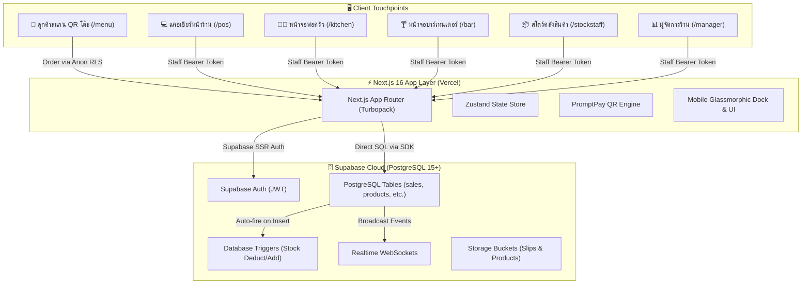
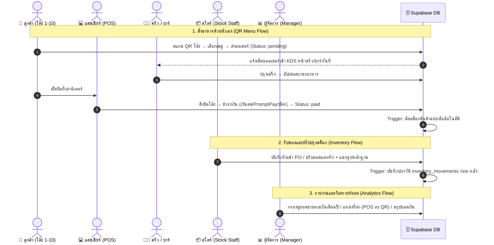
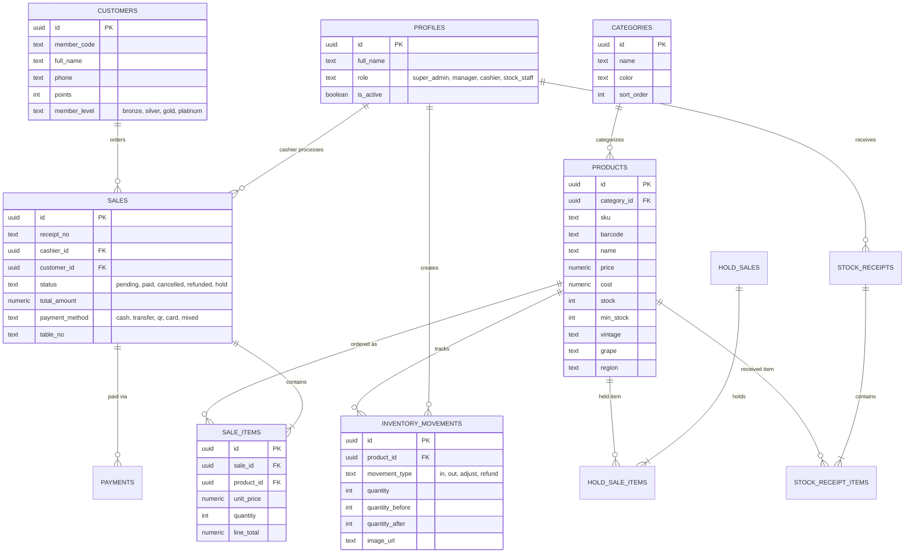

# 🍷 The Wine Cellar POS & Restaurant Bar System
> ระบบจัดการการขายหน้าร้าน (POS), ครัว (KDS), บาร์, คลังสินค้า (Stock Staff), รายงานผู้จัดการ (Manager Analytics) และเมนูสั่งอาหารผ่าน QR Code (Customer Self-Ordering) สำหรับร้านไวน์และภัตตาคารในเครือ **The Bottle Club**

[](https://nextjs.org/)
[](https://react.dev/)
[](https://tailwindcss.com/)
[](https://supabase.com/)
[](https://pos-thebottleclub-web-eta.vercel.app/pos)

---

## 📋 สารบัญ (Table of Contents)
1. [ภาพรวมระบบและสถาปัตยกรรม (System Overview & Architecture)](#1-ภาพรวมระบบและสถาปัตยกรรม)
2. [ระบบทำงานยังไงและมีอะไรบ้าง (How It Works & Modules)](#2-ระบบทำงานยังไงและมีอะไรบ้าง)
3. [วิธีการสร้างและตั้งค่าฐานข้อมูล (Database Setup Guide)](#3-วิธีการสร้างและตั้งค่าฐานข้อมูล)
4. [โครงสร้างตารางฐานข้อมูลและ ER Diagram (Database Schema & ERD)](#4-โครงสร้างตารางฐานข้อมูลและ-er-diagram)
5. [การตั้งค่าตัวแปรสภาพแวดล้อม (Environment Variables)](#5-การตั้งค่าตัวแปรสภาพแวดล้อม)
6. [โครงสร้างโค้ดและโฟลเดอร์ (Codebase Structure)](#6-โครงสร้างโค้ดและโฟลเดอร์)
7. [ขั้นตอนการติดตั้งและรันเพื่อพัฒนาต่อ (Developer Getting Started)](#7-ขั้นตอนการติดตั้งและรันเพื่อพัฒนาต่อ)
8. [กฎทางธุรกิจและจุดสำคัญที่ต้องระวัง (Business Logic & Caveats)](#8-กฎทางธุรกิจและจุดสำคัญที่ต้องระวัง)

---

## 1. ภาพรวมระบบและสถาปัตยกรรม

ระบบ **The Wine Cellar POS** ถูกออกแบบเป็นสถาปัตยกรรมแบบ **Full-Stack Monorepo / Modern Web App**:
- **Frontend App**: พัฒนาด้วย **Next.js 16 (App Router + Turbopack)** ร่วมกับ **React 19** และ **Tailwind CSS v4**
- **UI/UX Design**: ธีม **Cream & Cobalt** ผสมผสาน **White Glassmorphism** (กระจกเงาแก้ว 3 มิติ พร้อมเอฟเฟกต์แสงสะท้อน) รองรับทั้งจอ Desktop, POS Touch Screen และ Mobile 100%
- **Backend & Database**: ทำงานบน **Supabase (PostgreSQL 15+)** พร้อมระบบ Realtime WebSockets, Row Level Security (RLS) และ Database Triggers สำหรับตัดสต็อกอัตโนมัติ
- **Payment Integration**: สร้าง **PromptPay QR Code แบบ Dynamic** พร้อมระบุยอดเงินทศนิยมอัตโนมัติผ่าน `promptpay-qr`



---

## 2. ระบบทำงานยังไงและมีอะไรบ้าง

ระบบครอบคลุม 6 โมดูลหลักตามหน้าที่การทำงาน (Role-Based Workflows):



### รายละเอียดหน้าและฟังก์ชันการทำงาน

| เส้นทาง (Route) | บทบาทที่ใช้งาน | ฟังก์ชันและคุณสมบัติหลัก |
| :--- | :--- | :--- |
| **`/login`** | ทุกคน | ล็อกอินเข้าสู่ระบบด้วย Email/Password ตรวจสอบ Role และเปลี่ยนเส้นทางอัตโนมัติ |
| **`/pos`** | Cashier, Manager | - แค็ตตาล็อกสินค้าไวน์และอาหาร แยกหมวดหมู่ ค้นหาด้วยชื่อ/Barcode<br>- ตะกร้าสินค้า คุมจำนวน เพิ่มส่วนลดรายตัวหรือทั้งบิล<br>- ค้นหาสมาชิก สะสมแต้ม คำนวณแต้มแลกสิทธิประโยชน์<br>- พักบิลชั่วคราว (`Hold`) และเรียกบิลเดิมกลับมาขายต่อ<br>- ชำระเงิน: เงินสด (มีเครื่องคำนวณเงินทอน), Dynamic PromptPay QR, บัตรเครดิต, โอนเงิน<br>- ปริ้นท์ใบเสร็จอย่างย่อสำหรับเครื่องพิมพ์เทอร์มอล |
| **`/pos/history`** | Cashier, Manager | ดูประวัติบิลย้อนหลัง, พิมพ์ใบเสร็จซ้ำ (Reprint), ทำเรื่องคืนเงิน (Refund) |
| **`/pos/holds`** | Cashier | รายการบิลที่พักไว้ (Suspended Orders) ดึงกลับเข้าสู่การขายได้ทันที |
| **`/cashier`** | Cashier | จัดการคิวออเดอร์หน้าร้าน, ออเดอร์ที่สั่งมาจาก QR Menu โต๊ะ, รวมบิล และเคลียร์ยอด |
| **`/kitchen`** | Kitchen Staff | Kitchen Display System (KDS) แสดงรายการอาหารที่ต้องทำตามลำดับเวลาและเบอร์โต๊ะ |
| **`/bar`** | Bar Staff | Bar Display System แสดงรายการเครื่องดื่ม ไวน์เปิดขวด และค็อกเทล |
| **`/stockstaff`** | Stock Staff | - บันทึกการรับเข้าสินค้า (Stock Receiving PO) พร้อมแนบใบส่งของ<br>- ปรับปรุงยอดสต็อก (Stock Adjustment) ระบุเหตุผล: ชำรุด, แตกหัก, นับสต็อกจริง, สินค้าชิม พร้อมอัปโหลดรูปหลักฐาน |
| **`/manager`** | Manager, Super Admin | - แดชบอร์ดสรุปยอดขาย (รายวัน, รายสัปดาห์, รายเดือน, กำหนดวันเดือนปีเอง)<br>- แยกสัดส่วนยอดขายตามวิธีชำระ (เงินสด, QR, บัตร, โอน)<br>- แยกสัดส่วนยอดขายระหว่าง **หน้าร้าน POS** และ **ลูกค้าสั่งผ่าน QR Menu**<br>- รายงานตรวจสอบสต็อกสินค้าและประวัติการปรับปรุงยอดของพนักงานคลัง |
| **`/menu`** | ลูกค้าทั่วไป (Public) | เมนูดิจิทัลสำหรับลูกค้าสแกน QR ประจำโต๊ะ สั่งอาหารและไวน์ได้โดยไม่ต้องล็อกอิน |

---

## 3. วิธีการสร้างและตั้งค่าฐานข้อมูล

ฐานข้อมูลระบบทำงานบน PostgreSQL ของ Supabase สามารถตั้งค่าได้ 2 ทาง:

### วิธีที่ 1: ตั้งค่าบน Supabase Cloud (แนะนำสำหรับ Production)

1. สมัครและสร้าง Project ใหม่ที่ [supabase.com](https://supabase.com)
2. เข้าไปที่เมนู **SQL Editor** ทางด้านซ้าย
3. นำไฟล์สคริปต์ SQL ในโฟลเดอร์ `supabase/migrations/` ไปวางและกด **Run** ตามลำดับดังนี้:
   - **`001_wine_pos_schema.sql`** : สร้างตารางทั้งหมด 12 ตาราง, Indexes, Trigger ตัดสต็อกอัตโนมัติ และ RLS พื้นฐาน
   - **`002_setup_guide.sql`** : เพิ่มข้อมูลเริ่มต้น (หมวดหมู่สินค้าไวน์, รายการอาหาร, การตั้งค่าร้าน, และผู้ใช้งานตัวอย่าง)
   - **`003_update_settings_rls.sql`** : อัปเดตสิทธิ์ความปลอดภัยให้อ่านค่าตั้งค่าร้านได้
   - **`004_allow_public_menu_ordering.sql`** : เปิดสิทธิ์ RLS ให้ลูกค้าทั่วไปที่สแกน QR สั่งอาหารเข้าตาราง `sales` ได้
   - **`005_add_image_url_to_stock_receipts.sql`** : เพิ่มคอลัมน์แนบรูปใบเสร็จการรับเข้าสินค้า
   - **`006_add_image_url_to_inventory_movements.sql`** : เพิ่มคอลัมน์แนบรูปหลักฐานการปรับปรุงสต็อก

4. **สร้าง Storage Buckets สำหรับอัปโหลดไฟล์ภาพ**:
   - ไปที่ **Storage** -> **Create bucket**
   - Bucket ชื่อ: `receipts` (ตั้งค่าเป็น **Public bucket** สำหรับสลิปและใบเสร็จ)
   - Bucket ชื่อ: `products` (ตั้งค่าเป็น **Public bucket** สำหรับภาพสินค้า)

5. **สร้างบัญชีผู้ใช้งานเริ่มต้น (Initial Staff Accounts)**:
   - ไปที่เมนู **Authentication** -> **Users** -> **Add user**
   - สร้างผู้ใช้ เช่น `admin@bottleclub.com` พร้อมรหัสผ่าน
   - ไปที่ตาราง `profiles` ใน Table Editor แล้วผูก `id` ให้ตรงกับ `auth.users.id` โดยกำหนด `role` ให้ตรงตามหน้าที่:
     - `super_admin` หรือ `manager` (เข้าได้ทุกระบบรวมถึง `/manager`)
     - `cashier` (เข้าได้ `/pos`, `/pos/history`, `/cashier`)
     - `stock_staff` (เข้าได้ `/stockstaff`)

---

### วิธีที่ 2: ตั้งค่า Local Database ด้วย Docker & Prisma (สำหรับ Offline Dev)

หากต้องการรันฐานข้อมูลทดสอบในเครื่องโดยไม่ต่ออินเทอร์เน็ต:
```bash
# 1. รัน PostgreSQL และ Redis ผ่าน Docker
docker-compose up -d

# 2. ทำการ Migrate โครงสร้างตารางด้วย Prisma
cd packages/prisma
npx prisma db push

# 3. ใส่ข้อมูลเริ่มต้น (Seed Data)
npx ts-node seed.ts
```

---

## 4. โครงสร้างตารางฐานข้อมูลและ ER Diagram



### รายละเอียด Trigger สำคัญในฐานข้อมูล
- **`reduce_stock_on_sale()`**: ทำงานเมื่อมีการแทรกแถวใหม่ใน `sale_items` ระบบจะตัดยอด `stock` ใน `products` ทันที และบันทึกประวัติการลดสต็อกลง `inventory_movements` โดยอัตโนมัติ
- **`increase_stock_on_receipt()`**: ทำงานเมื่อบันทึกรับสินค้าใน `stock_receipt_items` ระบบจะเพิ่มจำนวนสต็อกให้สินค้าทันที

---

## 5. การตั้งค่าตัวแปรสภาพแวดล้อม

สร้างไฟล์ `apps/web/.env.local` เพื่อระบุการเชื่อมต่อไปยัง Supabase:

```bash
# apps/web/.env.local

# 1. URL ของ Supabase Project (หาได้จาก Settings -> API ใน Dashboard)
NEXT_PUBLIC_SUPABASE_URL=https://your-project-id.supabase.co

# 2. Public Anon Key สำหรับฝั่ง Browser เข้าถึงผ่าน RLS
NEXT_PUBLIC_SUPABASE_ANON_KEY=eyJhbGciOiJIUzI1NiIsInR5cCI6IkpXVCJ9...
```

> [!NOTE]
> ระบบฝั่ง Web ใช้ `@supabase/ssr` ในการจัดการ Cookie Session อัตโนมัติ จึงไม่ต้องใส่ Service Role Key ในฝั่ง Client เพื่อความปลอดภัยสูงสุด

---

## 6. โครงสร้างโค้ดและโฟลเดอร์

```
pos-system/
├── apps/
│   └── web/                               # Next.js 16 Web Application
│       ├── public/                        # Static assets (logo, audio, icons)
│       └── src/
│           ├── app/
│           │   ├── (auth)/login/          # หน้าเข้าสู่ระบบ
│           │   ├── (pos)/                 # โมดูลขายหน้าร้าน
│           │   │   ├── layout.tsx         # Top Header, Glassmorphic Bottom Dock & Hamburger Menu
│           │   │   ├── page.tsx           # หน้าจอขาย POS หลัก ตะกร้า และระบบคิดเงิน
│           │   │   ├── history/page.tsx   # ประวัติการขายและใบเสร็จ
│           │   │   └── holds/page.tsx     # รายการบิลที่พักไว้
│           │   ├── (cashier)/cashier/     # หน้าจอเตรียมของและจัดการคิวแคชเชียร์
│           │   ├── (kitchen)/kitchen/     # หน้าจอ KDS พ่อครัว
│           │   ├── (bar)/bar/             # หน้าจอบาร์เทนเดอร์
│           │   ├── (manager)/manager/     # แดชบอร์ดผู้จัดการและรายงานสต็อก/ยอดขาย
│           │   ├── (stockstaff)/...       # พอร์ทัลพนักงานคลังสินค้า
│           │   ├── (menu)/menu/           # เมนูสั่งอาหารสำหรับลูกค้า (QR Code)
│           │   ├── api/                   # Server API routes
│           │   ├── globals.css            # Global CSS, Cream & Cobalt variables
│           │   └── layout.tsx             # Root Layout
│           ├── components/                # Reusable UI components
│           └── lib/
│               ├── supabase/              # Supabase Client (@supabase/ssr)
│               ├── types.ts               # Shared TypeScript Interfaces & Types
│               └── utils.ts               # ฟังก์ชันคำนวณเงิน, Format วันที่, สิทธิ์ผู้ใช้
├── packages/
│   ├── prisma/                            # Prisma Schema & Local Database Seeds
│   └── types/                             # Shared TypeScript packages
├── supabase/
│   └── migrations/                        # รวมไฟล์ SQL Migrations 001 - 006
├── docker-compose.yml                     # Docker สำหรับ Local Postgres + Redis
├── package.json                           # Root Monorepo configuration
└── README.md                              # คู่มือฉบับนี้
```

---

## 7. ขั้นตอนการติดตั้งและรันเพื่อพัฒนาต่อ

### สิ่งที่ต้องเตรียม (Prerequisites)
- **Node.js**: เวอร์ชัน `18.18.0` หรือ `20.x` ขึ้นไป
- **npm**: เวอร์ชัน 9 หรือ 10+ (หรือ `pnpm`)
- **Git**

### ขั้นตอนการรันโปรเจกต์ (Step-by-Step)

```bash
# 1. โคลนโปรเจกต์
git clone https://github.com/Knathip01/PosTHEBOTTLECLUB.git
cd PosTHEBOTTLECLUB

# 2. ติดตั้ง Dependencies ทั้งหมดใน Monorepo
npm install

# 3. ตั้งค่า Environment Variables สำหรับ Web App
cp apps/web/.env.example apps/web/.env.local
# แล้วเปิดแก้ไข apps/web/.env.local ใส่ SUPABASE_URL และ SUPABASE_ANON_KEY

# 4. รันโปรเจกต์ในโหมด Development
npm run dev

# 5. เปิดเว็บบราวเซอร์
# ระบบจะรันอยู่ที่: http://localhost:3000
```

### การตรวจสอบและทดสอบ Build
ก่อนส่งมอบงานหรือเปิด Pull Request แนะนำให้ทดสอบ Build:
```bash
npm --prefix apps/web run build
```

---

## 8. กฎทางธุรกิจและจุดสำคัญที่ต้องระวัง

> [!IMPORTANT]
> **1. การคำนวณและตัดสต็อกสินค้า**:
> อย่าเขียนโค้ดตัดสต็อกซ้ำซ้อนในฝั่ง JavaScript เพราะตาราง `sale_items` มี Trigger `reduce_stock_on_sale` ทำงานตัดสต็อกและบันทึก log ที่ฝั่ง Database โดยตรงอยู่แล้ว

> [!TIP]
> **2. การสร้าง PromptPay QR Code**:
> ใช้ฟังก์ชัน `generatePayload(promptPayId, { amount })` จากไลบรารี `promptpay-qr` โดย `amount` ต้องเป็นเลขทศนิยมแท้จริง เพื่อให้ลูกค้าสแกนจ่ายได้ตรงยอดเป๊ะโดยไม่ต้องกรอกเอง

> [!WARNING]
> **3. การรักษาความเข้ากันได้บนมือถือ (Mobile Responsive)**:
> แถบนำทางด้านล่าง (`Mobile Bottom Dock`) และปุ่มตะกร้าลอย (`.cart-fab`) มีการคำนวณระยะห่างด้วย `env(safe-area-inset-bottom)` เพื่อไม่ให้ทับซ้อนกับ Home Bar ของ iPhone/iPad ห้ามลบระยะ `bottom: calc(env(safe-area-inset-bottom, 0px) + 84px)` ออก

---

**ผู้พัฒนาปัจจุบัน**: The Bottle Club Engineering Team  
**เวอร์ชันเอกสาร**: 1.0.0 (ปรับปรุงล่าสุด ตุลาคม 2026)
