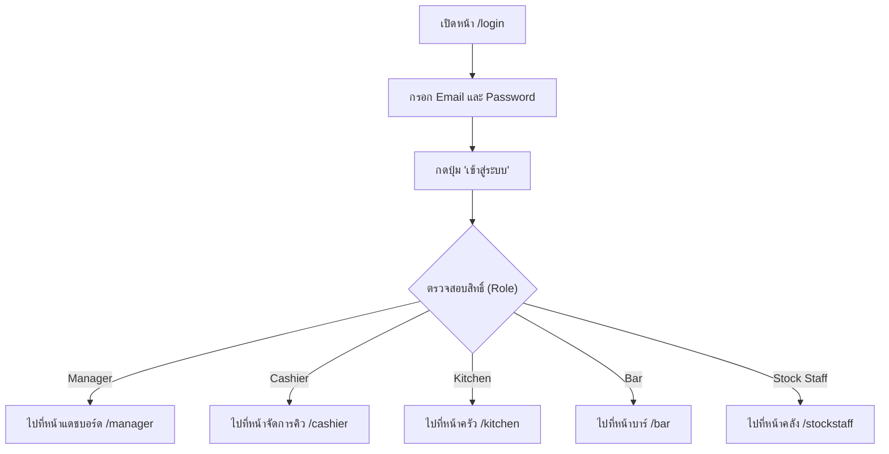
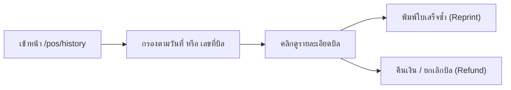
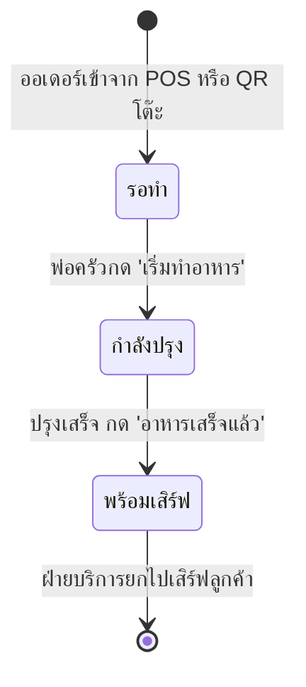
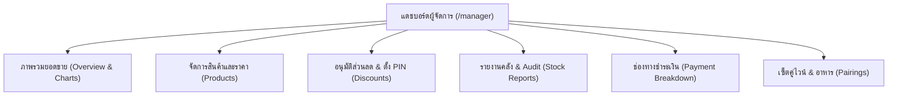

# 🍷 คู่มือการใช้งานระบบ The Wine Cellar POS & Restaurant System
> **เอกสารคู่มือการปฏิบัติงานสำหรับพนักงานทุกแผนก (Staff Operation Manual)**  
> ร้านอาหารและบาร์ไวน์ในเครือ The Bottle Club

---

## 📋 สารบัญ (Table of Contents)
1. [โครงสร้างบทบาทหน้าที่และสิทธิ์การเข้าใช้งาน (Roles & Permissions)](#1-โครงสร้างบทบาทหน้าที่และสิทธิ์การเข้าใช้งาน)
2. [หน้าจอที่ 1: เข้าสู่ระบบ (`/login`)](#2-หน้าจอที่-1-เข้าสู่ระบบ-login)
3. [หน้าจอที่ 2: จุดขายหน้าร้าน POS (`/pos`)](#3-หน้าจอที่-2-จุดขายหน้าร้าน-pos-pos)
4. [หน้าจอที่ 3: ประวัติการขายย้อนหลัง (`/pos/history`)](#4-หน้าจอที่-3-ประวัติการขายย้อนหลัง-poshistory)
5. [หน้าจอที่ 4: รายการบิลที่พักไว้ (`/pos/holds`)](#5-หน้าจอที่-4-รายการบิลที่พักไว้-posholds)
6. [หน้าจอที่ 5: จัดการคิวออเดอร์และเตรียมของ (`/cashier`)](#6-หน้าจอที่-5-จัดการคิวออเดอร์และเตรียมของ-cashier)
7. [หน้าจอที่ 6: หน้าจอห้องครัว KDS (`/kitchen`)](#7-หน้าจอที่-6-หน้าจอห้องครัว-kds-kitchen)
8. [หน้าจอที่ 7: หน้าจอบาร์เทนเดอร์ (`/bar`)](#8-หน้าจอที่-7-หน้าจอบาร์เทนเดอร์-bar)
9. [หน้าจอที่ 8: คลังสินค้าและสโตร์ (`/stockstaff`)](#9-หน้าจอที่-8-คลังสินค้าและสโตร์-stockstaff)
10. [หน้าจอที่ 9: แดชบอร์ดผู้จัดการร้าน (`/manager`)](#10-หน้าจอที่-9-แดชบอร์ดผู้จัดการร้าน-manager)
11. [หน้าจอที่ 10: เมนูสั่งอาหารของลูกค้า (`/menu`)](#11-หน้าจอที่-10-เมนูสั่งอาหารของลูกค้า-menu)
12. [สรุปกรณีฉุกเฉินและวิธีแก้ไขปัญหาเบื้องต้น (Troubleshooting)](#12-สรุปกรณีฉุกเฉินและวิธีแก้ไขปัญหาเบื้องต้น)

---

## 1. โครงสร้างบทบาทหน้าที่และสิทธิ์การเข้าใช้งาน

ระบบแบ่งสิทธิ์การทำงานตามตำแหน่งงานอย่างชัดเจนเพื่อความปลอดภัยสูงสุด:

| ตำแหน่ง (Role) | หน้าจอหลักที่ใช้งาน | สิทธิ์และความรับผิดชอบหลัก |
| :--- | :--- | :--- |
| **Cashier (แคชเชียร์)** | `/cashier`, `/pos`, `/pos/history`, `/pos/holds` | เปิดบิล, รับชำระเงิน (เงินสด/QR), ค้นหาสมาชิก, พักบิล, ติดตามคิวเสิร์ฟอาหาร |
| **Kitchen Staff (ครัว)** | `/kitchen` | ดูรายการอาหารตามโต๊ะ, กดเริ่มทำ, กดแจ้งอาหารเสร็จพร้อมเสิร์ฟ |
| **Bar Staff (บาร์)** | `/bar` | ดูรายการไวน์เปิดขวด/เครื่องดื่ม, เตรียมเครื่องดื่ม, กดแจ้งพร้อมเสิร์ฟ |
| **Stock Staff (สโตร์)** | `/stockstaff` | รับสินค้าเข้าคลัง (PO), ปรับยอดชำรุด/แตกหัก, ถ่ายรูปหลักฐาน, เช็คสต็อกคงเหลือ |
| **Manager (ผู้จัดการ)** | `/manager` (และเข้าได้ทุกหน้าจอ) | ดูรายงานยอดขาย, จัดการสินค้า, อนุมัติส่วนลด (PIN/Online), เช็คบัญชีร้าน |
| **Customer (ลูกค้า)** | `/menu?table=XX` | สแกน QR ประจำโต๊ะเพื่อดูเมนูและสั่งอาหารได้ด้วยตนเอง |

---

## 2. หน้าจอที่ 1: เข้าสู่ระบบ (`/login`)

ใช้สำหรับการระบุตัวตนของพนักงานทุกคนก่อนเริ่มงาน

### ขั้นตอนการใช้งาน:
1. เปิดเว็บบราวเซอร์แล้วไปที่ `https://pos-thebottleclub-web-eta.vercel.app/login`
2. กรอก **อีเมล (Email)** และ **รหัสผ่าน (Password)** ประจำตัวพนักงาน
3. กดปุ่ม **"เข้าสู่ระบบ"**
4. ระบบจะนำทางไปยังหน้าจอการทำงานของแผนกท่านโดยอัตโนมัติ

> [!WARNING]
> **ระบบป้องกันความปลอดภัย:** หากกรอกรหัสผ่านผิดติดต่อกันเกิน 5 ครั้ง ระบบจะทำการระงับการล็อกอินชั่วคราวเป็นเวลา 60 วินาที เพื่อป้องกันการสุ่มรหัสผ่าน

---

## 3. หน้าจอที่ 2: จุดขายหน้าร้าน POS (`/pos`)

หน้าจอหลักสำหรับแคชเชียร์ในการขายสินค้า คิดเงิน และพิมพ์ใบเสร็จ

### 3.1 การค้นหาและเพิ่มสินค้าลงตะกร้า
* **ค้นหาด้วยชื่อหรือบาร์โค้ด:** พิมพ์ชื่อไวน์ หรือยิงบาร์โค้ดสินค้าที่ช่องค้นหาด้านบน
* **กรองตามหมวดหมู่:** กดแท็บประเภทสินค้า เช่น ไวน์แดง (Red Wine), ไวน์ขาว (White Wine), อาหาร (Food)
* **คลิกที่การ์ดสินค้า:** เพื่อเพิ่มสินค้าลงตะกร้า 1 ชิ้นทันที

### 3.2 โปรโมชั่นจับคู่พิเศษ (Food & Wine Pairing)
* ด้านบนของรายการสินค้าจะมีส่วน **"เซ็ตคู่ไวน์ & อาหาร"**
* เมื่อลูกค้าสั่งไวน์คู่กับอาหารที่ร่วมรายการ ให้กดปุ่ม **"เพิ่มคู่นี้ลงตะกร้า"** ระบบจะคำนวณส่วนลดคู่พิเศษให้ทันที (เช่น ลด 110 - 200 บาท)

### 3.3 การจัดการตะกร้าสินค้า (Cart Management)
* **เพิ่ม/ลดจำนวน:** กดปุ่ม `+` หรือ `-` ที่รายการสินค้า
* **ลบรายการ:** กดไอคอนถังขยะสีแดง `🗑️`
* **สมาชิกสะสมแต้ม (Member):**
  1. กดปุ่ม **"ค้นหาสมาชิก"**
  2. พิมพ์ชื่อหรือเบอร์โทรศัพท์ของลูกค้า
  3. ระบบจะแสดงระดับสมาชิก (Bronze/Silver/Gold/Platinum) และแต้มสะสมปัจจุบัน
  4. ทุกยอดซื้อ 100 บาท ลูกค้าจะได้รับ 1 แต้มโดยอัตโนมัติ

### 3.4 การใส่ส่วนลด (Discount)
* กดปุ่ม **"ใส่ส่วนลด"**
* สามารถเลือกเปอร์เซ็นต์ส่วนลดมาตรฐาน (10%, 20%, 30% ฯลฯ)
* **กรณีส่วนลดสูงกว่าเกณฑ์ที่กำหนด:** ระบบจะแสดงหน้าต่างขออนุมัติ:
  - **ตัวเลือกที่ 1 (ใส่ PIN ผู้จัดการ):** ให้ผู้จัดการร้านกรอกรหัส PIN 4 หลักเพื่ออนุมัติทันที
  - **ตัวเลือกที่ 2 (ส่งคำขอออนไลน์):** ส่ง Notification ไปยังหน้าจอของผู้จัดการเพื่อกด Approve จากระยะไกล

### 3.5 การพักบิลชั่วคราว (Hold Bill)
* หากลูกค้ายังไม่พร้อมจ่ายเงิน หรือต้องการสั่งเพิ่มในภายหลัง:
  - กดปุ่ม **"พักบิล (Hold)"**
  - ใส่หมายเลขโต๊ะ หรือชื่อลูกค้า
  - บิลจะถูกบันทึกเก็บไว้ และตะกร้าจะถูกเคลียร์ว่างเพื่อรับลูกค้ารายต่อไปได้ทันที

### 3.6 การชำระเงิน (Checkout)
กดปุ่มสีน้ำเงิน **"ชำระเงิน"** หน้าต่าง Checkout Modal จะปรากฏขึ้น มี 2 รูปแบบการชำระ:

#### แบบที่ 1: เงินสด (Cash) 💵
1. กดเลือกแท็บ **"เงินสด"**
2. กดตัวเลขจำนวนเงินที่รับจากลูกค้าผ่านปุ่ม Numpad บนหน้าจอ หรือกดปุ่มลัด (เช่น ฿500, ฿1,000)
3. ระบบจะคำนวณ **"เงินทอน"** ให้แบบอัตโนมัติ
4. ทอนเงินให้ลูกค้า จากนั้นกดปุ่ม **"ยืนยันรับเงินสด"**

#### แบบที่ 2: สแกน QR พร้อมเพย์ (PromptPay QR) 📱
1. กดเลือกแท็บ **"สแกน QR"**
2. ระบบจะสร้าง **Dynamic PromptPay QR Code** ตามยอดเงินของบิลนั้นแบบอัตโนมัติ (มีเวลาชำระเงินนับถอยหลัง 5 นาที)
3. ให้ลูกค้านำแอปธนาคารมาสแกนจ่ายเงิน
4. เมื่อลูกค้าโอนสำเร็จ:
   - กดปุ่ม **"ถ่ายรูปสลิป 📸"** เพื่อเปิดกล้องถ่ายหลักฐานจากหน้าจอมือถือลูกค้า
   - หรือกดปุ่ม **"เลือกรูปสลิป"** หากลูกค้าส่งรูปสลิปให้
5. กรอกเลขอ้างอิงสลิป (Reference No.) หากต้องการ
6. กดปุ่ม **"ยืนยันการชำระเงิน"**

### 3.7 การพิมพ์ใบเสร็จ (Thermal Receipt Printing)
* เมื่อทำรายการสำเร็จ ระบบจะแสดงหน้าสรุปยอดพร้อมปุ่ม **"พิมพ์ใบเสร็จ"**
* กดปุ่มพิมพ์ ระบบจะสั่งพิมพ์ไปยังเครื่องพิมพ์เทอร์มอล 80mm ทันที โดยมีข้อมูลครบถ้วน:
  - เลขที่ใบเสร็จ, วันที่และเวลา
  - รายชื่อสินค้า, จำนวน, ราคาต่อหน่วย, ราคารวมแต่ละรายการ
  - ส่วนลด, ยอดสุทธิ, วิธีการชำระเงิน, เงินทอน
  - ชื่อแคชเชียร์ผู้ทำรายการ และแต้มสะสมของลูกค้า

---

## 4. หน้าจอที่ 3: ประวัติการขายย้อนหลัง (`/pos/history`)

ใช้สำหรับตรวจสอบรายการขายย้อนหลัง พิมพ์ใบเสร็จซ้ำ หรือทำเรื่องคืนเงิน

### การใช้งานหลัก:
1. **ค้นหาบิล:** ค้นหาตามเลขที่ใบเสร็จ (เช่น `#REC-202610...`) หรือกรองตามช่วงวันที่ (Date From - Date To)
2. **พิมพ์ใบเสร็จซ้ำ (Reprint):** กดไอคอนเครื่องพิมพ์ `🖨️` เพื่อออกบิลใหม่อีกครั้งในกรณีบิลเดิมชำรุดหรือลูกค้าขอเพิ่ม
3. **การคืนเงิน/ยกเลิกรายการ (Refund):**
   - เฉพาะรายการที่มีปัญหา เช่น บันทึกผิด หรือลูกค้ายกเลิก
   - กดปุ่ม **"คืนเงิน"** ยอดขายจะเปลี่ยนสถานะเป็น `refunded` และสต็อกสินค้าจะถูกคืนเข้าคลังโดยอัตโนมัติ

---

## 5. หน้าจอที่ 4: รายการบิลที่พักไว้ (`/pos/holds`)

หน้าจอสำหรับจัดการบิลที่แคชเชียร์กดพักไว้จากหน้า POS

### การใช้งานหลัก:
1. **ดูรายการบิลที่พักอยู่:** จะแสดงชื่อลูกค้า/หมายเลขโต๊ะ, เวลาที่พักบิล, จำนวนรายการ และยอดเงิน
2. **เรียกบิลกลับมาขายต่อ (Resume):**
   - กดปุ่ม **"เรียกบิลคืน" (Resume)**
   - ระบบจะดึงรายการสินค้าและข้อมูลลูกค้ากลับเข้าสู่ตะกร้าของหน้า `/pos` ทันทีเพื่อให้คิดเงินต่อได้สะดวกรวดเร็ว
3. **ลบบิลพัก (Cancel/Delete):** หากลูกค้ายกเลิกโต๊ะ ให้กดไอคอนถังขยะ `🗑️` เพื่อลบบิลพักนั้นออก

---

## 6. หน้าจอที่ 5: จัดการคิวออเดอร์และเตรียมของ (`/cashier`)

หน้าจอสำหรับพนักงานบริการและแคชเชียร์ เพื่อติดตามสถานะการทำอาหาร/เครื่องดื่มจากห้องครัวและบาร์แบบ Real-time

### คุณสมบัติเด่น:
* **ระบบเสียงแจ้งเตือนอัตโนมัติ (Sound Alert):** เมื่อห้องครัวหรือบาร์เทนเดอร์กดทำอาหารเสร็จ หน้าจอจะส่งเสียง **"ติ๊งหน่อง 🔔"** เพื่อให้พนักงานบริการรีบไปยกอาหารมาเสิร์ฟ
* **ติดตามสถานะของอาหารและเครื่องดื่ม:**
  - `[ครัว: กำลังปรุง / พร้อมเสิร์ฟ]`
  - `[บาร์: กำลังชง / พร้อมเสิร์ฟ]`
* **การกดเสิร์ฟอาหาร:**
  - เมื่อนำอาหาร/เครื่องดื่มไปส่งที่โต๊ะลูกค้าเรียบร้อยแล้ว ให้กดปุ่ม **"ทำเครื่องหมายว่าเสิร์ฟแล้ว"** การ์ดจะเปลี่ยนเป็นสถานะเสิร์ฟเสร็จสมบูรณ์
* **การดูรูปสลิป:** มีไอคอนรูปภาพให้คลิกดูรูปสลิปโอนเงินของลูกค้าได้ตลอดเวลา

---

## 7. หน้าจอที่ 6: หน้าจอห้องครัว KDS (`/kitchen`)

หน้าจอ Kitchen Display System สำหรับพ่อครัวและพนักงานในครัว (ทำงานผ่าน iPad/แท็บเล็ต หรือจอสัมผัสในครัว)

### การใช้งานหลัก:
1. **กรองเฉพาะอาหารโดยอัตโนมัติ:** หน้าจอนี้จะไม่แสดงรายการไวน์หรือเครื่องดื่ม เพื่อไม่ให้รบกวนการทำงานของพ่อครัว
2. **ตัวนับเวลาอาหาร (Elapsed Timer):**
   - แต่ละการ์ดจะมีเวลานับว่าออเดอร์นี้สั่งมาแล้วกี่นาที
   - หากรอนานเกินเวลา การ์ดจะมีแถบเตือนสีส้ม/แดง เพื่อให้เร่งทำ
3. **ขั้นตอนการกดสถานะ:**
   - สถานะที่ 1: `⏳ รอทำ` (Pending) — ออเดอร์เพิ่งเข้า
   - สถานะที่ 2: กดปุ่ม **"เริ่มทำ"** — เปลี่ยนเป็น `🔥 กำลังปรุง` เพื่อให้ทีมงานรู้ว่าจานนี้ลงกระทะแล้ว
   - สถานะที่ 3: ปรุงเสร็จ กดปุ่ม **"อาหารเสร็จแล้ว"** — เปลี่ยนเป็น `✅ พร้อมเสิร์ฟ` (ระบบจะส่งเสียงเตือนไปที่หน้าจอแคชเชียร์หน้าร้านทันที)

---

## 8. หน้าจอที่ 7: หน้าจอบาร์เทนเดอร์ (`/bar`)

หน้าจอ Bar Display System สำหรับบาร์เทนเดอร์และพนักงานดูแลเครื่องดื่ม

### การใช้งานหลัก:
1. **กรองเฉพาะเครื่องดื่มและไวน์:** แสดงเฉพาะไวน์เปิดขวด, เบียร์, ค็อกเทล, ม็อกเทล, สปาร์คลิ่งไวน์ และของหวาน
2. **ขั้นตอนการกดสถานะ:**
   - สถานะที่ 1: `⏳ รอเตรียม` (Pending) — ลูกค้าสั่งเครื่องดื่ม
   - สถานะที่ 2: กดปุ่ม **"เริ่มเตรียม"** — เปลี่ยนเป็น `🍸 กำลังชง/รินไวน์`
   - สถานะที่ 3: เตรียมเสร็จ กดปุ่ม **"พร้อมเสิร์ฟ"** — ระบบจะแจ้งฝ่ายบริการให้มายกแก้ว/ขวดไวน์ไปเสิร์ฟที่โต๊ะ

---

## 9. หน้าจอที่ 8: คลังสินค้าและสโตร์ (`/stockstaff`)

หน้าจอสำหรับเจ้าหน้าที่คลังสินค้าเพื่อตรวจนับ รับของเข้า และตัดยอดสูญเสีย/แตกหัก

### แถบที่ 1: รับเข้าสินค้า (Receive Stock) 📥
1. กรอก **ชื่อผู้จัดจำหน่าย (Supplier)** และหมายเหตุการส่งของ
2. เลือกรายการสินค้าไวน์หรือวัตถุดิบที่รับเข้า
3. กรอก **จำนวนที่รับเข้า (Quantity)** และ **ราคาทุนต่อหน่วย (Cost)**
4. **ถ่ายรูปหลักฐาน:** กดปุ่ม **"ถ่ายรูปใบเสร็จ 📸"** หรือกดเลือกไฟล์ภาพ เพื่อแนบใบส่งสินค้า / Invoice
5. กดปุ่ม **"บันทึกรับเข้าคลัง"** สต็อกสินค้าจะเพิ่มขึ้นในระบบทันที

### แถบที่ 2: ปรับปรุงยอดสต็อก (Adjust Stock) 🔄
ใช้สำหรับตัดยอดสินค้าที่ไม่สามารถจำหน่ายได้ หรือปรับยอดตามการตรวจนับจริง:
1. เลือกสินค้าที่ต้องการปรับปรุง
2. เลือกเหตุผลการปรับสต็อก:
   - `ขวดแตก / ชำรุด (Broken/Damaged)`
   - `สินค้าสำหรับชิม / ทดลอง (Tasting)`
   - `นับสต็อกจริงไม่ตรง (Physical Count Adjustment)`
   - `สูญหาย (Lost)`
3. ระบุจำนวนที่ต้องการเพิ่ม (+) หรือลด (-)
4. ถ่ายภาพสินค้าที่แตกหักหรือหลักฐานแนบไว้
5. กดปุ่ม **"บันทึกการปรับยอด"** ระบบจะบันทึก Log ลงในประวัติความเคลื่อนไหวสต็อกทันที

### แถบที่ 3: เช็คสต็อกคงเหลือ (Stock Check) 📋
* ตรวจสอบจำนวนคงเหลือปัจจุบันของไวน์ทุกตัว
* รายการที่มีสต็อกต่ำกว่าเกณฑ์ขั้นต่ำ (Min Stock) จะมีสัญลักษณ์แจ้งเตือนสีส้ม เพื่อให้สั่งซื้อเพิ่มได้ทันท่วงที

---

## 10. หน้าจอที่ 9: แดชบอร์ดผู้จัดการร้าน (`/manager`)

ศูนย์กลางการควบคุม วิเคราะห์ และตั้งค่าระบบสำหรับผู้จัดการร้านและผู้บริหาร

### รายละเอียดแต่ละแท็บในหน้า Manager:
1. **ภาพรวม (Overview):**
   - สรุปยอดขายรวมวันนี้, ยอดขายเดือนนี้, จำนวนบิลทั้งหมด, ยอดเฉลี่ยต่อบิล
   - กราฟแนวโน้มยอดขายตามช่วงเวลา (Revenue Area Chart)
   - สินค้าขายดี 5 อันดับแรก (Top Selling Wines & Food)
2. **จัดการสินค้า (Products):**
   - เพิ่มรายการไวน์ใหม่, ปรับราคาขาย, เปลี่ยนรูปภาพ, กำหนดหมวดหมู่
3. **อนุมัติส่วนลด (Discounts):**
   - ตั้งรหัส **Manager PIN 4 หลัก** สำหรับให้แคชเชียร์ใช้ขอลดราคาหน้าร้าน
   - หน้าต่างกดอนุมัติ (Approve) หรือปฏิเสธ (Reject) เมื่อแคชเชียร์ส่งคำขอออนไลน์
4. **รายงานช่องทางชำระเงิน (Payments):**
   - เปรียบเทียบสัดส่วนยอดเงินสด (Cash) กับยอดสแกน QR พร้อมเพย์
5. **รายงานร้านค้า (Shop Reports):**
   - เปรียบเทียบยอดขายที่เปิดบิลผ่าน **POS หน้าร้าน** กับยอดที่ **ลูกค้าสแกนสั่งเองผ่าน QR โต๊ะ**
6. **จัดการเซ็ตจับคู่ (Food & Wine Pairings):**
   - เพิ่มหรือแก้ไขโปรโมชั่นคู่ไวน์และอาหาร เพื่อเพิ่มยอดขาย Up-selling หน้าร้าน

---

## 11. หน้าจอที่ 10: เมนูสั่งอาหารของลูกค้า (`/menu`)

หน้าเว็บบนมือถือสำหรับลูกค้าที่มานั่งรับประทานในร้าน:
1. **ลูกค้าใช้มือถือสแกน QR Code ประจำโต๊ะ** (เช่น โต๊ะ 1 จะได้ลิงก์ `/menu?table=1`)
2. เมนูจะแสดงรายการอาหารและไวน์อย่างสวยงาม พร้อมราคาและรูปภาพ
3. ลูกค้าเลือกอาหารใส่ตะกร้าและกด **"ส่งออเดอร์"**
4. รายการอาหารจะวิ่งตรงไปยังหน้าจอ **ห้องครัว (`/kitchen`)** และ **บาร์ (`/bar`)** โดยอัตโนมัติ โดยที่ลูกค้าไม่ต้องรอเรียกพนักงาน

---

## 12. สรุปกรณีฉุกเฉินและวิธีแก้ไขปัญหาเบื้องต้น

| ปัญหาที่พบ | สาเหตุ | วิธีการแก้ไข |
| :--- | :--- | :--- |
| **ล็อกอินไม่ผ่าน / บัญชีถูกล็อค** | ใส่รหัสผ่านผิดเกิน 5 ครั้ง | รอเวลาตัวเลขนับถอยหลัง 60 วินาทีให้หมด แล้วกรอกใหม่อย่างระมัดระวัง |
| **พิมพ์ใบเสร็จไม่ออก** | บราวเซอร์บล็อกป๊อปอัป (Pop-up) | ให้กดอนุญาต Always allow pop-ups จากเว็บไซต์ที่แถบ URL ของบราวเซอร์ |
| **กล้องถ่ายสลิป/ใบเสร็จไม่เปิด** | ยังไม่ได้อนุญาต Camera Permission | กดที่ไอคอนแม่กุญแจหน้ารายการ URL บนบราวเซอร์ แล้วเลือกเปิดการเข้าถึง Camera |
| **ครัวไม่ได้รับออเดอร์** | สัญญาณอินเทอร์เน็ตหลุดชั่วคราว | กดปุ่ม Refresh (ลูกศรหมุนวน) ที่มุมขวาบนของหน้าจอครัว หรือกด F5 |
| **ต้องการยกเลิกบิลที่คิดเงินผิด** | แคชเชียร์ไม่มีสิทธิ์ลบบิลโดยตรง | ให้แจ้งผู้จัดการร้านเพื่อเข้าไปที่หน้า `/pos/history` แล้วกดทำเรื่องคืนเงิน (Refund) |

---
*จัดทำขึ้นเพื่อให้การดำเนินงานภายในร้าน The Bottle Club เป็นไปอย่างราบรื่น ถูกต้อง และมีมาตรฐานสูงสุด*
